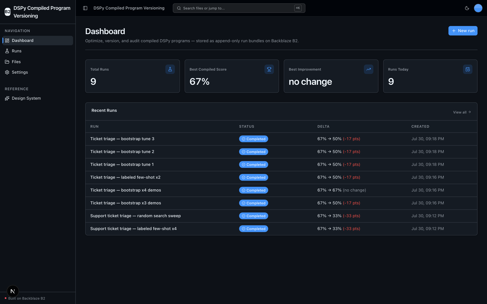
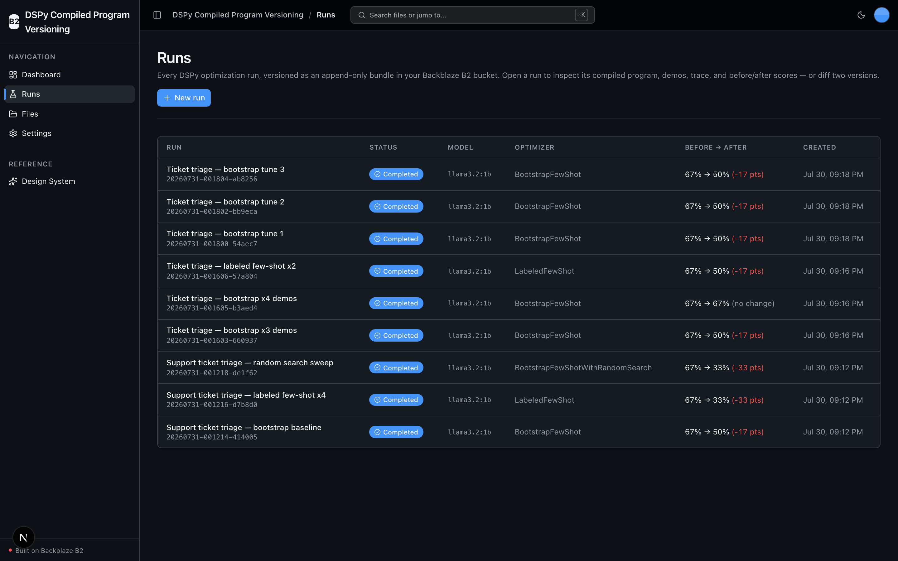
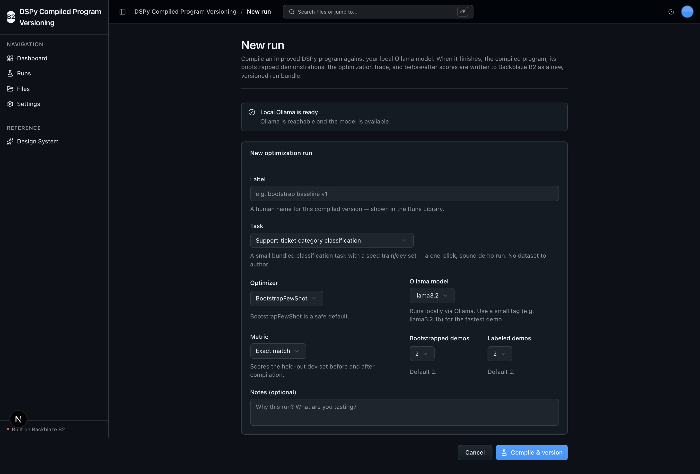
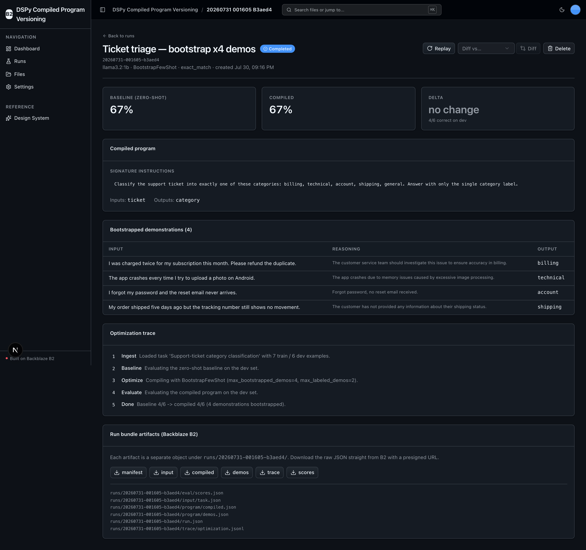
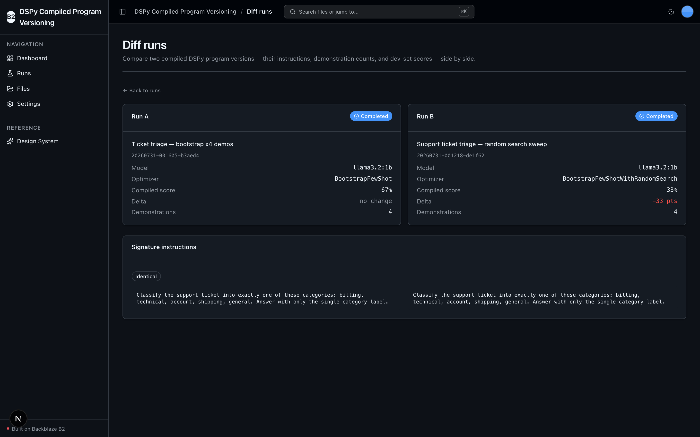

<!-- last_verified: 2026-07-30 -->
# DSPy Compiled Program Versioning

Version, evaluate, diff, and roll back **compiled [DSPy](https://github.com/stanfordnlp/dspy) programs** — using **[Backblaze B2](https://www.backblaze.com/sign-up/ai-cloud-storage?utm_source=github&utm_medium=referral&utm_campaign=ai_artifacts&utm_content=b2ai-dspy-compiled-program-versioning)** as the durable, auditable memory layer for a prompt-optimization workflow that runs **entirely offline against a local [Ollama](https://ollama.com) model**.

Each optimization run compiles an improved DSPy program (prompts + bootstrapped few-shot demonstrations) against a local model, then appends the compiled program, the demonstration set, the full optimization trace, and before/after evaluation scores to B2 as a structured, versioned **run bundle**. Runs accumulate append-only, so you can browse every prior compiled program, diff two versions, roll back, or replay an old program against a new model — a reproducible, rollback-capable prompt-engineering audit trail.

**The only credentials you need are B2 keys.** The LLM is a local Ollama model — no second API key, no per-token billing. B2 is exercised entirely through the **S3-compatible API** with a custom user agent and standardized `B2_*` env vars.

## What it looks like

**Dashboard** — total runs, best compiled score, best improvement, and runs-today metrics above a recent-runs table.



**Runs Library** — every optimization run versioned on B2, with status, model, optimizer, and before→after score delta.



**New run** — a one-click create form with selectors for task, optimizer, model, metric, and demo counts, gated by a live Ollama health check.



**Run detail** — the compiled prompt, bootstrapped demonstrations, optimization trace, before/after scorecard, and the run's downloadable B2 run-bundle artifacts.



**Diff runs** — two compiled versions compared across config, dev-set scores, and signature instructions.



## Why B2 for this workflow

Prompt optimization is expensive to redo and easy to lose. A compiled DSPy program is a real artifact — prompts, bootstrapped demonstrations, and the scores that justify them. Keeping every compiled version in B2 turns an ephemeral `optimizer.compile()` call into a **durable, comparable, rollback-capable history**:

- **Append-only run bundles** — each run writes its input, compiled program, demos, trace, and scores as immutable S3 objects under its own prefix. Nothing overwrites a prior version.
- **Auditable** — every run records the exact config, the optimization trace, and the before/after dev-set scores that produced it.
- **Reproducible** — replay any prior run's config (optionally against a new model) to reproduce or re-baseline it.
- **Cheap and durable** — B2 object storage is the right home for many small, versioned JSON artifacts you rarely delete.

## What it does

- **Optimize & version compiled DSPy programs** — bootstrap/compile an improved program against a local Ollama model; persist the compiled program + demos to B2 as a new version each run.
- **Before/after evaluation** — `dspy.Evaluate`-style scoring of the zero-shot baseline vs the compiled program on a held-out dev set; both stored alongside the program.
- **Runs Library** — browse every optimization run stored under the sample's B2 prefix; open, replay, delete, or diff.
- **Diff & rollback / replay** — diff two compiled programs (instructions, demos, scores) and replay any prior run's config against a new model.
- **Runs entirely offline on local OSS** — DSPy + Ollama; B2 credentials are the only keys.

The bundled demo task is a small **support-ticket category classification** problem with a seed train/dev set, so a sound demo run is one click — no dataset to author.

## Prerequisites

You need: Node.js >= 20, pnpm >= 9, Python >= 3.11, a free **[Backblaze B2 account](https://www.backblaze.com/sign-up/ai-cloud-storage?utm_source=github&utm_medium=referral&utm_campaign=ai_artifacts&utm_content=b2ai-dspy-compiled-program-versioning)**, and a local **Ollama** install.

### Install Ollama and pull a model

```bash
# macOS: brew install ollama   |   Linux: curl -fsSL https://ollama.com/install.sh | sh
ollama serve            # start the local server (http://localhost:11434)
ollama pull llama3.2    # or, for the fastest demo: ollama pull llama3.2:1b
```

Ollama picks the device automatically (Metal on macOS, CUDA on Linux, CPU otherwise) — **no GPU is required**; the sample runs CPU-only. A smaller tag (e.g. `llama3.2:1b`) compiles faster. The app's health check surfaces whether Ollama is reachable and whether your configured model is pulled, so a missing model produces a clear message rather than a failed run.

### Supported local environments

Local scripts are supported on macOS, Linux, and WSL2. Native Windows is not supported (POSIX shell + `services/api/.venv/bin/*` paths); use WSL2.

## Setup

**1. Run setup**

```bash
pnpm run setup
```

This copies `.env.example` to `.env` (only if missing), installs workspace dependencies from `pnpm-lock.yaml`, creates `services/api/.venv`, and installs the API's committed Python 3.11 resolution from `services/api/requirements.lock` (including DSPy). Safe to rerun; never overwrites an existing `.env`.

> Use the `pnpm run` form: `setup` (like `doctor`) is a built-in pnpm command before pnpm 11, so bare `pnpm setup` would run pnpm's own command instead of this script.

**2. Add your B2 credentials**

Open `.env` and, from the [Backblaze B2 dashboard](https://secure.backblaze.com/b2_buckets.htm?utm_source=github&utm_medium=referral&utm_campaign=ai_artifacts&utm_content=b2ai-dspy-compiled-program-versioning):

1. **Create a bucket** and paste its **Bucket Unique Name** → `B2_BUCKET_NAME`. Set `B2_REGION` to the bucket's region (e.g. `us-east-005`); the S3 endpoint is derived as `https://s3.<region>.backblazeb2.com`.
2. **Create an application key** with `Read and Write` permission and paste:
   - **keyID** → `B2_APPLICATION_KEY_ID`
   - **applicationKey** → `B2_APPLICATION_KEY` *(shown once — paste it now)*

The Ollama settings (`OLLAMA_BASE_URL`, `OLLAMA_MODEL`) default to `http://localhost:11434` and `llama3.2`; change them in `.env` to use a different local model.

> Walkthroughs: [creating a bucket](https://www.backblaze.com/docs/cloud-storage-create-and-manage-buckets?utm_source=github&utm_medium=referral&utm_campaign=ai_artifacts&utm_content=b2ai-dspy-compiled-program-versioning), [creating app keys](https://www.backblaze.com/docs/cloud-storage-create-and-manage-app-keys?utm_source=github&utm_medium=referral&utm_campaign=ai_artifacts&utm_content=b2ai-dspy-compiled-program-versioning).

**3. Run it**

```bash
pnpm dev
```

Frontend at `localhost:3000`, API at `localhost:8000`. Go to **Runs → New run**, launch a run, and watch it compile against your local model and write its bundle to B2. Interactive API docs at `localhost:8000/docs`.

`pnpm dev` runs a preflight check first (`pnpm run doctor`) that catches common setup gotchas (wrong Node/Python version, missing venv, missing or placeholder `.env`, busy ports).

## Run-bundle layout on B2

Every run is an append-only prefix in your bucket (S3-compatible API only — no b2-native calls):

```
runs/<run_id>/run.json                 # manifest: label, status, model, optimizer, metric, timestamps, score summary
runs/<run_id>/input/task.json          # input bundle: signature/instructions + seed train/dev datasets
runs/<run_id>/program/compiled.json    # DSPy program.save() JSON state (prompts + demos), human-diffable
runs/<run_id>/program/demos.json       # bootstrapped few-shot demonstration set
runs/<run_id>/trace/optimization.jsonl # per-step optimization trace
runs/<run_id>/eval/scores.json         # before vs after metric scores
```

Each artifact is written as a separate `put_object` as its step completes. Deleting a run is a recursive delete scoped strictly to `runs/<run_id>/`.

| Operation | S3 API call |
|---|---|
| Write run-bundle artifacts | `put_object` |
| List run bundles under `runs/` | `list_objects_v2` |
| Pull a compiled program (detail / diff / replay) | `get_object` |
| Download a raw artifact | `generate_presigned_url` |
| Delete a run bundle (recursive over `runs/<id>/`) | `delete_object` |
| Full-bucket browse (Files explorer) | `list_objects_v2` |

## App surface

- **Dashboard** (`/`) — total runs, best compiled score, best improvement, runs today, and a recent-runs table.
- **Runs** (`/runs`) — the Runs Library: every optimization run with status, model, optimizer, and before→after score delta. Open a run for its compiled prompt, demos table, optimization trace, before/after scorecard, and the actions **Replay**, **Delete**, and **Diff vs…**.
- **New run** (`/runs/new`) — a create form with selectors for every finite field (task, optimizer, model, metric, demo counts) and safe defaults for a one-click demo run.
- **Files** (`/files`) — the full Backblaze B2 bucket explorer, complementary to the Runs Library. Browse, preview, download, and delete any object, including raw run-bundle artifacts.
- **Settings** (`/settings`) and **Design System** (`/design`).

## Architecture note (Agent-First)

This app is built on a strict, mechanically-enforced layered architecture (`types -> config -> repo -> service -> runtime`). All DSPy/Ollama access is contained in `services/api/app/repo/dspy_runner.py` and all B2 access in `repo/run_store.py` + `repo/b2_client.py` (a single boto3 S3 client with one custom user agent). `boto3` never appears outside `repo/`. See [AGENTS.md](AGENTS.md) and [ARCHITECTURE.md](ARCHITECTURE.md).

## Tech Stack

- TypeScript, Next.js 16, React 19, Tailwind v4, shadcn/ui, TanStack Query
- Python 3.11+, FastAPI, boto3, Pydantic v2, **DSPy** (`dspy>=2.5,<3`)
- **Ollama** — local LLM runtime (no API key)
- Backblaze B2 (S3-compatible object storage)
- pnpm workspaces (monorepo)

## Commands

| Command | What it does |
|---------|-------------|
| `pnpm run setup` | Idempotently copy `.env.example` to `.env` if missing, install deps, create the venv, install locked API deps |
| `pnpm run doctor` | Preflight environment check (also runs before `pnpm dev`) |
| `pnpm dev` | Start frontend + backend |
| `pnpm dev:web` / `pnpm dev:api` | Frontend only / backend only |
| `pnpm contract:export` | Export deterministic FastAPI OpenAPI JSON to `docs/api/openapi.json` |
| `pnpm contract:check` | Verify the OpenAPI artifact + frontend API client route registry |
| `pnpm check:agent-docs` | Validate agent shims, command docs, CI claims, and `.env` ignore coverage |
| `pnpm verify` | Credential-free non-live pre-PR suite (`check:agent-docs`, `verify:api`, `verify:web`) |
| `pnpm verify:api` | Backend: lint, tests, structure |
| `pnpm verify:web` | Frontend: lint, unit tests, typecheck + build |
| `pnpm verify:full` | `pnpm run doctor`, then `pnpm verify`, then Playwright E2E (needs real `.env`, local server/browser, port 3000 free) |
| `pnpm lint` / `pnpm lint:api` | Lint frontend / backend |
| `pnpm test:web` / `pnpm test:api` | Frontend / backend tests |

The backend tests mock the B2 repo layer and the DSPy runner, so `pnpm verify` needs neither B2 credentials nor a running Ollama server. To exercise a real end-to-end run you need B2 credentials and a local Ollama model pulled.

## Documentation Map

| Doc | Purpose |
|-----|---------|
| [AGENTS.md](AGENTS.md) | Agent table of contents — start here |
| [ARCHITECTURE.md](ARCHITECTURE.md) | System layout, layering, data flows |
| [docs/features/](docs/features/) | Feature docs (optimization runs, versioning, run library, evaluation, diff & replay, dashboard, file browser, settings) |
| [docs/app-workflows.md](docs/app-workflows.md) | User journeys |
| [docs/dev-workflows.md](docs/dev-workflows.md) | Engineering workflows and testing |
| [docs/SECURITY.md](docs/SECURITY.md) | Security principles |
| [docs/RELIABILITY.md](docs/RELIABILITY.md) | Reliability expectations |

## License

MIT License - see [LICENSE](LICENSE) for details.

## Claude Agent B2 Skill

Manage Backblaze B2 from your terminal using natural language (list/search, audits, stale or large file detection, security checks, safe cleanup).

Repo: [https://github.com/backblaze-b2-samples/claude-skill-b2-cloud-storage](https://github.com/backblaze-b2-samples/claude-skill-b2-cloud-storage)
